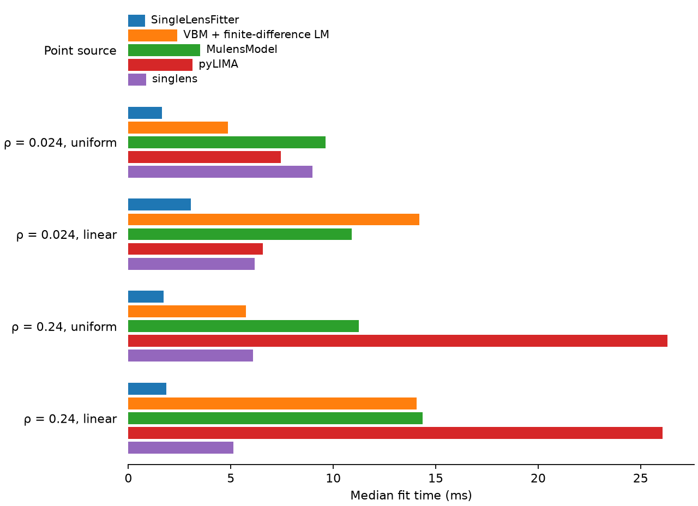
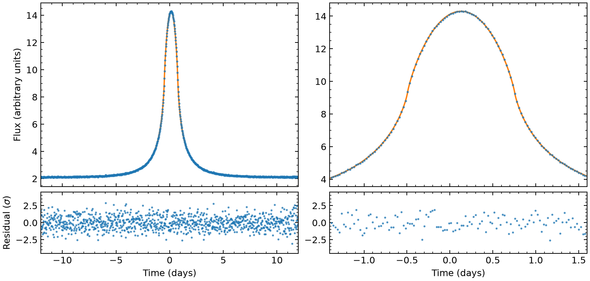

# SingleLensFitter

Fit single-band gravitational microlensing light curves with a point lens and
either a point source (PSPL) or a finite source (FSPL). Both fitters support
annual and satellite parallax. Finite-source models also support linear limb darkening.
SingleLensFitter began as the single-lens fitting code in `jacscanomaly`.

## Install

Requires Python 3.10+ and a C++17 compiler with OpenMP. On macOS, set
`SINGLELENSFITTER_DISABLE_OPENMP=1` to build with Apple Clang.

```sh
python -m pip install SingleLensFitter
```

## Fit a light curve

Pass one-dimensional arrays of observation times in days, fluxes, and positive
one-sigma flux uncertainties.

```python
from singlelensfitter import FSPLFitter

fit = FSPLFitter().fit(time, flux, flux_err)
print(fit.optimizer_success, dict(zip(fit.param_names, fit.params)))
print(fit.chi2, fit.fs, fit.fb)
```

## How the fit works

For a point source, an FFT template search finds starting values for the peak
time, Einstein time, and impact parameter. For a finite source, the fitter
uses the observed peak width to try combinations of source radius (`rho`) and
scaled impact parameter (`u0/rho`), and ranks these starting points by chi-square.

The fitter refines multiple starting points by weighted least squares using
model derivatives. At each step it solves for the source and blend fluxes
analytically.

See the [API guide](https://github.com/NunotaKansuke/SingleLensFitter/blob/main/docs/api.md)
for point-source fits, limb darkening, parallax, and derivatives.

## Benchmarks

On one Xeon Gold 6530 core, the development version fit synthetic light curves
with 1,000 observations in 0.81 ms (point source) and
1.64–3.04 ms (finite source) with NumPy output, starting from supplied parameters. The comparison uses identical
photometry, initial geometry and optimizer stopping rules across packages.

[](benchmarks/comparison.md#matched-seeded-fits)

[Fit settings, exact timings and reference χ²](benchmarks/comparison.md#matched-seeded-fits)
· [Automatic fits and other benchmarks](benchmarks/README.md)

[](benchmarks/comparison.md#benchmark-light-curves)

Linear limb darkening, ρ = 0.24. Points show the synthetic observations and the line shows the SLF fit.
