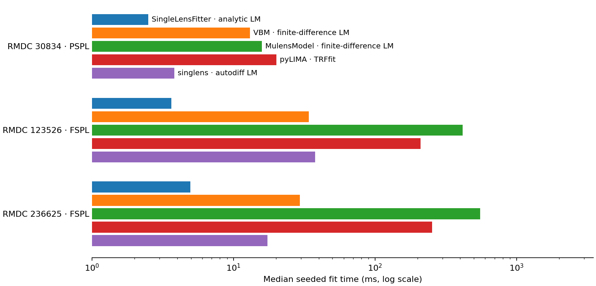
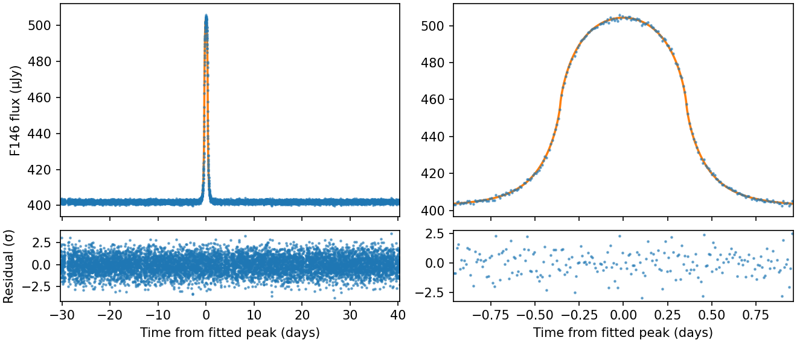
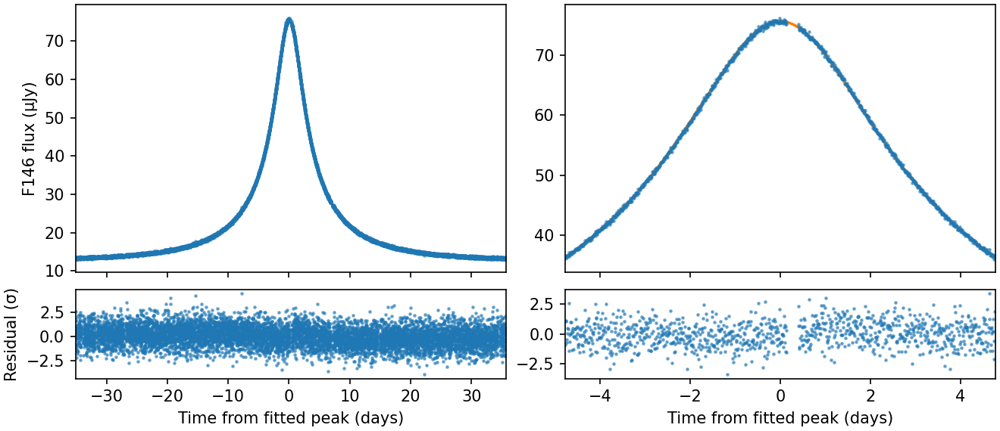
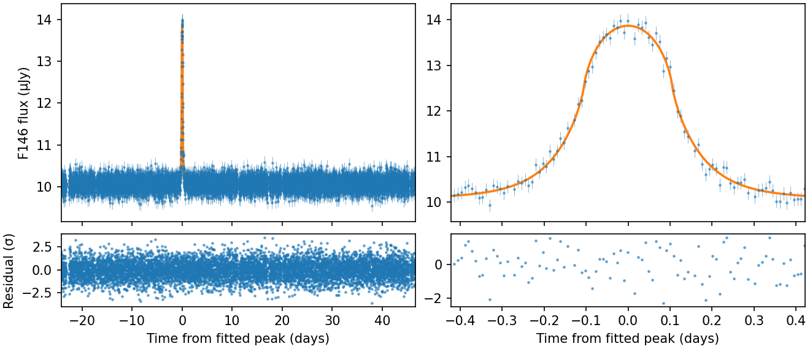

# Single-lens fit benchmarks

## RMDC26 seeded fits

Three RMDC26 events, about 7,700 F146 observations each, with the same starting geometry for all packages. Times are in milliseconds and show the fastest tested configuration per package and event (median of nine warmed fits on one CPU core).

| RMDC event · model | SingleLensFitter | VBM + finite-difference LM | MulensModel + finite-difference LM | pyLIMA TRFfit | singlens + autodiff LM |
|---|---:|---:|---:|---:|---:|
| 30834 · PSPL | 2.49 | 13.05 | 15.85 | 20.04 | 3.81 |
| 123526 · FSPL | 3.64 | 34.04 | 417.18 | 210.20 | 37.74 |
| 236625 · FSPL | 4.96 | 29.36 | 551.86 | 253.09 | 17.32 |

Data, timing and package settings

- **Data.** Unsaturated F146 photometry from the observing season containing the injected peak, with uniform brightness for the two finite-source fits. The event IDs, BJD ranges and starting geometries are in the [event manifest](rmdc/events.csv). [RGES PIT data guide](https://rges-pit.org/data-challenge/data/) · [RMDC26 Machine Learning dataset](https://huggingface.co/datasets/RGES-PIT/MachineLearning)
- Timing excludes setup, JIT compilation and automatic initialization. [Fitted parameters and reference χ²](rmdc/fits.csv)
- **[SingleLensFitter](https://github.com/NunotaKansuke/SingleLensFitter)** used seeded PSPL or FSPL with analytical derivatives. **[VBMicrolensing](https://github.com/valboz/VBMicrolensing)** used the batch light-curve API with tolerance 0.001 and finite-difference LM.
- **[MulensModel](https://github.com/rpoleski/MulensModel)** used point-source magnification outside the peak and `finite_source_uniform_Lee09` within five times the initial `tE × max(|u0|, rho)` on either side of the initial peak for FSPL. All epochs contributed to the fit.
- **[pyLIMA](https://github.com/ebachelet/pyLIMA)** used its native TRFfit with the original BJD, fitting fluxes for PSPL and profiling them for FSPLarge. Its native stopping tolerances were 10⁻¹⁰. The other four used LM with tolerances of 10⁻⁶.
- **[singlens](https://github.com/ShotaMiyazaki94/singlens)** used point-source magnification or its bundled uniform-source table, profiled fluxes, and supplied a JAX forward-mode Jacobian to SciPy LM in CPU float64.

**RMDC 236625.** F146 observations and the fitted uniform-source curve across the season (left) and near the peak (right). The lower panels show residuals in units of the reported photometric uncertainty.

Show the other two RMDC light curves

**RMDC 30834 · Point source**

**RMDC 123526 · Finite source**

