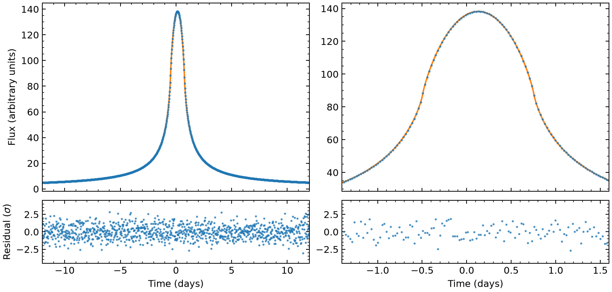

# Single-lens fit benchmarks

## Matched seeded fits

Each package fits the same 1,000 synthetic observations from the same initial
geometry using SciPy LM (`ftol = xtol = gtol = 10⁻⁶`). Cells give **median
time in ms / reference χ²** over nine warmed fits on one Xeon Gold 6530 core.
An independent model scores each fitted geometry. Compare χ² within a row.

| Source | SLF (development) | VBM | MulensModel | pyLIMA |
|---|---:|---:|---:|---:|
| Point source | 1.11 / 958.90 | 2.46 / 958.90 | 3.58 / 958.90 | 3.15 / 958.90 |
| ρ = 0.024, uniform | 2.09 / 961.20 | 5.09 / 979.00 | 9.83 / 961.83 | 7.49 / 961.83 |
| ρ = 0.024, linear | 3.84 / 961.05 | 32.08 / 969.79 | 11.27 / 961.58 | 6.78 / 961.58 |
| ρ = 0.24, uniform | 2.28 / 959.98 | 6.59 / 960.17 | 12.29 / 1022.81 | 28.08 / 960.17 |
| ρ = 0.24, linear | 2.42 / 959.89 | 29.61 / 959.98 | 15.38 / 1012.65 | 27.32 / 960.95 |

SLF uses analytical derivatives. The other columns share a two-point
finite-difference driver. For finite sources, VBM uses its batch API at 10⁻⁴
tolerance. MulensModel uses Gould94/Yoo04, small-source approximations whose
accuracy drops at ρ = 0.24. pyLIMA uses FSPL at ρ = 0.024 and FSPLarge at ρ = 0.24.

[All 297 measurements, including the SLF finite-difference control](matched_fits.csv)

### Benchmark light curves

Linear limb darkening, ρ = 0.24. Blue points show the synthetic photometry
with 1σ errors and the orange line shows the SLF fit. The right column enlarges
the peak. The lower panels give (observed − fitted flux) / σ.


<details>
<summary>Show the other four benchmark light curves</summary>

**Point source**


**Uniform source, ρ = 0.024**


**Linear limb darkening, ρ = 0.024**



**Uniform source, ρ = 0.24**


</details>

<details>
<summary>Data, solver settings and reproduction</summary>

- **Photometry.** 1,000 equally spaced epochs over ±12 days, peak at day 0.13,
  source and blend fluxes 1.7 and 0.4, Gaussian errors σ = 0.02, RNG seed 82.
  The point source has (tE, u₀) = (3, 0.12). Both transits have ρ tE = 0.72 days
  and u₀/ρ = 0.5. The linear limb-darkening coefficient is 0.5.
- **Initial geometry.** In (t₀, tE, u₀, ρ) order, the seeds are
  (0.25, 28, 0.014, 0.022) and (0.25, 2.8, 0.14, 0.22). The point-source
  seed is (0.25, 2.8, 0.14).
- **Fit and timing.** LM uses centered t₀, log tE, signed u₀, log ρ, unit
  scaling and a limit of 1,000 evaluations. Source and blend fluxes are
  profiled at every trial. Method order rotates. Setup and independent
  scoring are outside the timer.
- **Software.** The SLF build is based on the 0.1.4 release (`7cfa49d`) with the extended
  limb-darkening table. Install this checkout in the benchmark environment.
  [Dependencies and versions](README.md#reproduce)

```sh
python -m pip install .
export OMP_NUM_THREADS=1 OPENBLAS_NUM_THREADS=1 MKL_NUM_THREADS=1
taskset -c 28 python benchmarks/methods.py --matched > matched_fits.csv
python benchmarks/plot_lightcurves.py
```

[Benchmark script](methods.py) · [Earlier package-specific fits and Lee09 checks (CSV)](method_comparison.csv)

</details>
