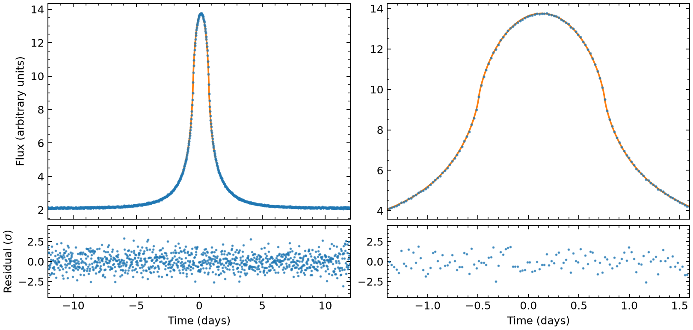

# Single-lens fit benchmarks

## Matched seeded fits

All five packages fit the same 1,000 observations from the same starting geometry.
Times are medians of nine warmed fits on one Xeon Gold 6530 core.


Cells show fit time and reference χ². Lower χ² indicates a closer fit within each row.

| Source | SLF (development) | VBM + finite-difference LM | MulensModel | pyLIMA TRFfit | singlens |
|---|---:|---:|---:|---:|---:|
| Point source | 0.81 ms (χ² = 958.90) | 2.39 ms (χ² = 958.90) | 3.51 ms (χ² = 958.90) | 5.00 ms (χ² = 958.90) | 0.86 ms (χ² = 958.90) |
| ρ = 0.024, uniform | 1.64 ms (χ² = 961.20) | 4.85 ms (χ² = 979.00) | 9.61 ms (χ² = 961.83) | 21.17 ms (χ² = 961.83) | 8.99 ms (χ² = 961.18) |
| ρ = 0.024, linear | 3.04 ms (χ² = 961.05) | 14.19 ms (χ² = 1069.18) | 10.91 ms (χ² = 961.58) | 19.15 ms (χ² = 961.58) | 6.17 ms (χ² = 961.04) |
| ρ = 0.24, uniform | 1.73 ms (χ² = 959.98) | 5.74 ms (χ² = 960.17) | 11.25 ms (χ² = 1022.81) | 43.46 ms (χ² = 960.17) | 6.09 ms (χ² = 959.98) |
| ρ = 0.24, linear | 1.85 ms (χ² = 959.89) | 14.06 ms (χ² = 960.95) | 14.37 ms (χ² = 1012.65) | 55.58 ms (χ² = 960.95) | 5.13 ms (χ² = 959.89) |

MulensModel uses a small-source approximation at both radii, including ρ = 0.24.

<details>
<summary>Show the APIs and options used for each package</summary>

| Package | API called by the benchmark | Mode and options |
|---|---|---|
| **[SingleLensFitter](https://github.com/NunotaKansuke/SingleLensFitter)** | `PSPLFitter.fit` or `FSPLFitter.fit` | Seeded LM with analytical derivatives. |
| **[VBMicrolensing 5.7](https://github.com/valboz/VBMicrolensing)** | `VBMicrolensing.PSPLLightCurve` or `ESPLLightCurve` with the full epoch list | ESPL table loaded once before timing. `Tol = RelTol = 1e-3`, `a1 = 0` or `0.5` and `minannuli = 1` (uniform) or `2` (linear). Fit with the benchmark’s finite-difference LM driver. |
| **[MulensModel 3.12.0](https://github.com/rpoleski/MulensModel)** | `Model.get_magnification(time, gamma=...)` | Standard point-lens mode, `finite_source_uniform_Gould94` or `finite_source_LD_Yoo04`. The benchmark sets `gamma = 2a/(3 − a)` and uses its finite-difference LM driver. |
| **[pyLIMA 1.9.8](https://github.com/ebachelet/pyLIMA)** | `TRFfit.fit()` with `model_parameters_guess` | `PSPLmodel` for point sources, `FSPLmodel` at ρ = 0.024 and `FSPLargemodel` at ρ = 0.24. Telescope options are `ld_a1 = a` and `ld_gamma = 2a/(3 − a)`. The native fitter initializes and fits fluxes, uses its own stopping rules, and computes covariance. The FSPLarge radius upper bound is 1. |
| **[singlens](https://github.com/ShotaMiyazaki94/singlens)** (`23bcf7a`) | `Model(source=...).magnification(times, Parameters(...))` | `source="point"`, `"uniform"` or `"linear"`. Finite sources use the bundled table through the default solver. The benchmark uses `jax.jit` and `jax.jacfwd` with CPU float64 and passes the Jacobian to SciPy LM. Initial compilation is recorded separately. |

[Shared LM driver](fits.py) · [Package calls and options](methods.py) · [singlens calls and options](singlens_fits.py)

</details>

[LM measurements](matched_fits.csv) · [pyLIMA TRFfit measurements](package_workflows.csv) · [singlens measurements and JIT warmup](singlens_fits.csv)

### Benchmark light curves

Linear limb darkening, ρ = 0.24. Blue points show the synthetic photometry
with 1σ errors and the orange line shows the SLF fit. The right column enlarges
the peak. The lower panels give (observed − fitted flux) / σ.


<details>
<summary>Show the other four benchmark light curves</summary>

**Point source**


**Uniform source, ρ = 0.024**


**Linear limb darkening, ρ = 0.024**


**Uniform source, ρ = 0.24**



</details>

<details>
<summary>Data, solver settings and reproduction</summary>

- **Photometry.** 1,000 equally spaced epochs over ±12 days, peak at day 0.13,
  source and blend fluxes 1.7 and 0.4, Gaussian errors σ = 0.02, RNG seed 82.
  The point source has (tE, u₀) = (3, 0.12). Both transits have ρ tE = 0.72 days
  and u₀/ρ = 0.5. The linear limb-darkening coefficient is 0.5.
- **Initial geometry.** In (t₀, tE, u₀, ρ) order, the seeds are
  (0.25, 28, 0.014, 0.022) and (0.25, 2.8, 0.14, 0.22). The point-source
  seed is (0.25, 2.8, 0.14).
- **Fit and timing.** LM uses centered t₀, log tE, signed u₀, log ρ, unit
  scaling and a limit of 1,000 evaluations. Source and blend fluxes are
  profiled at every trial. Method order rotates. Setup and independent
  scoring are outside the timer.
- **Software.** SLF uses NumPy output in these timings. [Environment and versions](README.md#reproduce)

```sh
python -m pip install .
export OMP_NUM_THREADS=1 OPENBLAS_NUM_THREADS=1 MKL_NUM_THREADS=1
taskset -c 28 python benchmarks/methods.py --matched > benchmarks/matched_fits.csv
taskset -c 28 python benchmarks/methods.py --workflows > benchmarks/package_workflows.csv
PYTHONPATH=/path/to/singlens/src JAX_PLATFORMS=cpu taskset -c 28 python benchmarks/singlens_fits.py > benchmarks/singlens_fits.csv
python benchmarks/plot_fit_times.py
python benchmarks/plot_lightcurves.py
```

[Benchmark script](methods.py) · [Earlier package-specific fits and Lee09 checks (CSV)](method_comparison.csv)

</details>
