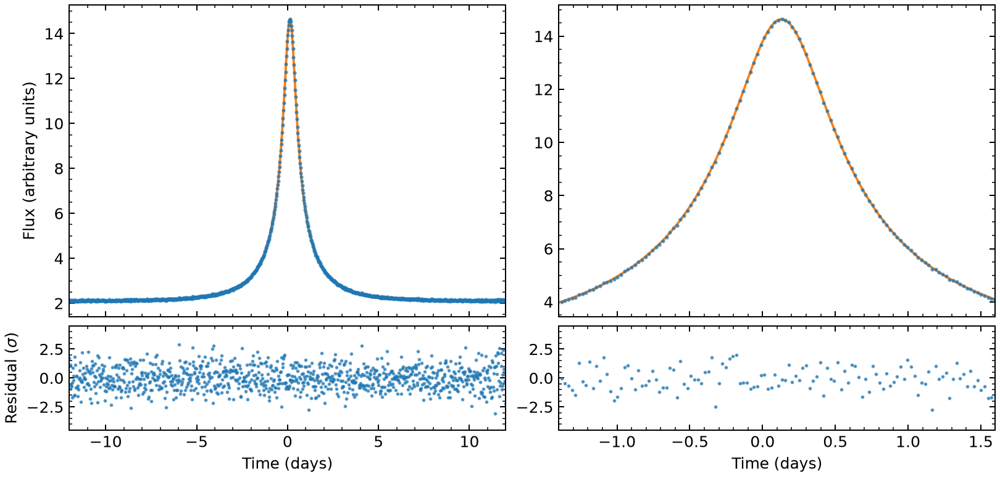

# Single-lens fit benchmarks

## Matched seeded fits

Each package fits the same 1,000 synthetic observations from the same initial
geometry using SciPy LM (`ftol = xtol = gtol = 1e-6`). Bars show the median
of nine warmed fits on one Xeon Gold 6530 core. Shorter bars mean faster fits.


Each cell gives the time followed by the reference χ² in parentheses.
The reference score uses independent magnification calculations at each
package’s fitted geometry and a new weighted fit of source and blend flux.
Lower χ² means closer agreement with the observations within that row.

| Source | SLF (development) | VBM + finite-difference LM | MulensModel | pyLIMA | singlens |
|---|---:|---:|---:|---:|---:|
| Point source | 0.81 ms (χ² = 958.90) | 2.39 ms (χ² = 958.90) | 3.51 ms (χ² = 958.90) | 3.13 ms (χ² = 958.90) | 0.86 ms (χ² = 958.90) |
| ρ = 0.024, uniform | 1.64 ms (χ² = 961.20) | 4.85 ms (χ² = 979.00) | 9.61 ms (χ² = 961.83) | 7.45 ms (χ² = 961.83) | 8.99 ms (χ² = 961.18) |
| ρ = 0.024, linear | 3.04 ms (χ² = 961.05) | 14.19 ms (χ² = 1069.18) | 10.91 ms (χ² = 961.58) | 6.57 ms (χ² = 961.58) | 6.17 ms (χ² = 961.04) |
| ρ = 0.24, uniform | 1.73 ms (χ² = 959.98) | 5.74 ms (χ² = 960.17) | 11.25 ms (χ² = 1022.81) | 26.31 ms (χ² = 960.17) | 6.09 ms (χ² = 959.98) |
| ρ = 0.24, linear | 1.85 ms (χ² = 959.89) | 14.06 ms (χ² = 960.95) | 14.37 ms (χ² = 1012.65) | 26.07 ms (χ² = 960.95) | 5.13 ms (χ² = 959.89) |

SLF uses analytical derivatives and singlens uses JAX autodiff. The other three series use a shared
two-point finite-difference driver. The MulensModel series uses a small-source
approximation for both radii; its reference χ² increases at ρ = 0.24.

<details>
<summary>Show the fitting algorithm and magnification modes</summary>

**How the fit works.** SciPy’s Levenberg–Marquardt solver adjusts the
geometry (peak time, Einstein time, impact parameter and, for finite sources,
source radius). At each trial, the selected magnification mode evaluates
`A(t)` at all observation epochs. A weighted two-parameter linear solve
gives the source flux and the blend flux in `F_model(t) = F_source × A(t) + F_blend`.
LM uses the residuals `(F_obs − F_model) / σ` and their Jacobian to propose the
next geometry. Each Jacobian accounts for the fluxes being solved again as
the geometry changes.

| Package | Magnification mode and Jacobian used for the plotted times |
|---|---|
| **[SingleLensFitter](https://github.com/NunotaKansuke/SingleLensFitter)** (development build) | Seeded `PSPLFitter.fit` or `FSPLFitter.fit` with its analytical Jacobian. Both fitters use `numpy_result=True` to return CPU results as NumPy arrays. PSPL uses the analytic point-lens formula. FSPL evaluates magnification and its partial derivatives in one C++ batch, using interpolation, direct integration near the limb where needed, and far-field formulas. Its analytic Jacobian also differentiates the flux solve; the linear coefficient is fixed at 0 or 0.5. The CSV also includes the same magnification model with two-point differences. |
| **[VBMicrolensing 5.7](https://github.com/valboz/VBMicrolensing)** | `PSPLLightCurve` or `ESPLLightCurve` evaluates all epochs in one batch. The engine, ESPL table and time list are prepared before timing. For finite sources, `Tol = RelTol = 1e-3`, `a1 = a` and `minannuli` is 1 for uniform or 2 for linear brightness. The CSV includes a separate run with engine defaults. |
| **[MulensModel 3.12.0](https://github.com/rpoleski/MulensModel)** | `Model.get_magnification` uses the standard point lens for PSPL, `finite_source_uniform_Gould94` for uniform FSPL and `finite_source_LD_Yoo04` for linear FSPL. The linear coefficient passed to the model is Γ = 2a/(3 − a). |
| **[pyLIMA 1.9.8](https://github.com/ebachelet/pyLIMA)** | The driver calls `model_magnification` on `PSPLmodel` for a point source, `FSPLmodel` (Yoo approximation) at ρ = 0.024, and `FSPLargemodel` (numerical finite source) at ρ = 0.24. The telescope carries both `ld_a1 = a` and `ld_gamma = 2a/(3 − a)`. Both finite-source models at both radii are in the CSV. |
| **[singlens](https://github.com/ShotaMiyazaki94/singlens)** | `Model(source="point" / "uniform" / "linear").magnification` uses the point-lens formula or the bundled finite-source table at commit `23bcf7a`. JAX `jit` and `jacfwd` evaluate the residual and its Jacobian in float64 on CPU, including flux profiling. Timing uses nine warmed fits on CPU 28 in a separate run with Python 3.11 and JAX 0.10.2. The CSV records the first compiled residual and Jacobian calls separately. |

The VBM, MulensModel and pyLIMA entries pass their magnification functions
to the benchmark’s SciPy LM driver. Its two-point differences perturb each
geometry parameter and reevaluate the full residual, including the flux solve.
[Common LM driver](fits.py) · [Package adapters](methods.py) · [singlens JAX adapter](singlens_fits.py)

The earlier comparison also includes pyLIMA’s native TRF fitter and the
MulensModel Event gradient workflow. [Earlier measurements](method_comparison.csv)

</details>

[All 297 measurements, including the SLF finite-difference control](matched_fits.csv) · [45 singlens fits and JIT warmup times](singlens_fits.csv)

### Benchmark light curves

Linear limb darkening, ρ = 0.24. Blue points show the synthetic photometry
with 1σ errors and the orange line shows the SLF fit. The right column enlarges
the peak. The lower panels give (observed − fitted flux) / σ.


<details>
<summary>Show the other four benchmark light curves</summary>

**Point source**



**Uniform source, ρ = 0.024**


**Linear limb darkening, ρ = 0.024**


**Uniform source, ρ = 0.24**


</details>

<details>
<summary>Data, solver settings and reproduction</summary>

- **Photometry.** 1,000 equally spaced epochs over ±12 days, peak at day 0.13,
  source and blend fluxes 1.7 and 0.4, Gaussian errors σ = 0.02, RNG seed 82.
  The point source has (tE, u₀) = (3, 0.12). Both transits have ρ tE = 0.72 days
  and u₀/ρ = 0.5. The linear limb-darkening coefficient is 0.5.
- **Initial geometry.** In (t₀, tE, u₀, ρ) order, the seeds are
  (0.25, 28, 0.014, 0.022) and (0.25, 2.8, 0.14, 0.22). The point-source
  seed is (0.25, 2.8, 0.14).
- **Fit and timing.** LM uses centered t₀, log tE, signed u₀, log ρ, unit
  scaling and a limit of 1,000 evaluations. Source and blend fluxes are
  profiled at every trial. Method order rotates. Setup and independent
  scoring are outside the timer.
- **Software.** The SLF build is based on the 0.1.4 release (`7cfa49d`) with the extended
  limb-darkening table. Install this checkout in the benchmark environment.
  [Dependencies and versions](README.md#reproduce)

```sh
python -m pip install .
export OMP_NUM_THREADS=1 OPENBLAS_NUM_THREADS=1 MKL_NUM_THREADS=1
taskset -c 28 python benchmarks/methods.py --matched > matched_fits.csv
PYTHONPATH=/path/to/singlens/src JAX_PLATFORMS=cpu taskset -c 28 python benchmarks/singlens_fits.py > benchmarks/singlens_fits.csv
python benchmarks/plot_fit_times.py
python benchmarks/plot_lightcurves.py
```

[Benchmark script](methods.py) · [Earlier package-specific fits and Lee09 checks (CSV)](method_comparison.csv)

</details>
